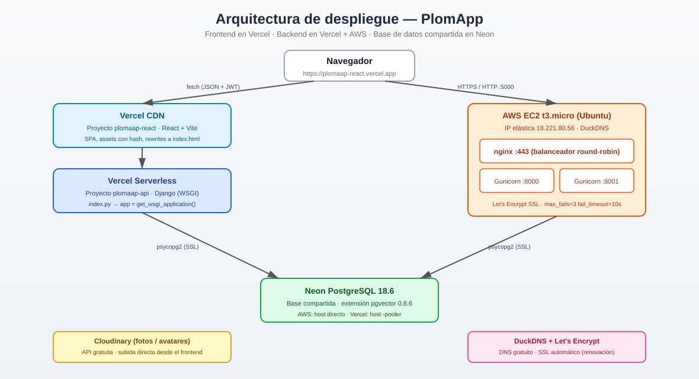

# PlomApp API — Backend Django (migración 1:1 desde Flask)


Este proyecto es la **migración completa del backend Flask** de PlomApp
(`backend_flask`) a **Django**, conservando el **mismo contrato de API**:
mismos endpoints, mismas rutas, mismos cuerpos JSON, mismos códigos de
estado, contraseñas bcrypt y tokens JWT HS256 con `sub` como cadena de
texto. El frontend React **no necesita ningún cambio**.

> Es una **API pura (headless)**: no incluye el panel de administración de
> Django (`/admin/`) ni autenticación por sesiones. Toda la autenticación es
> JWT y la interfaz de usuario es el frontend React. Ver [Seguridad](#seguridad).

## 🚀 Despliegue y arquitectura (producción)

PlomApp está **desplegado y funcionando** en dos backends que comparten la misma
base de datos Neon (PostgreSQL + pgvector):

| Servicio | URL | Estado |
|---|---|---|
| 🌐 Frontend React | https://plomaap-react.vercel.app | ✅ En vivo |
| ⚡ API principal (Vercel serverless) | https://plomaap-api.vercel.app/api | ✅ En vivo |
| 🖥️ API respaldo (AWS + nginx + SSL) | https://plomaap.duckdns.org/api | ✅ En vivo |
| ☁️ API en Oracle Cloud (Docker + Caddy) | https://lifeosandres.duckdns.org/plomaap-api/api | ✅ En vivo |
| ⚖️ **API Global Load Balancer (HAProxy)** | https://plomaaplb.158-247-126-81.nip.io/api | ✅ En vivo |
| 📊 Dashboard de stats (HAProxy) | https://plomaaplb.158-247-126-81.nip.io/stats | ✅ (auth: admin/plomaap2026) |
| 🗄️ Base de datos | Neon (Vercel/AWS/Oracle unificado) | ✅ |

### Arquitectura



```mermaid
flowchart TD
    Browser["🌐 Navegador"]
    VCDN["Vercel CDN<br/>Frontend React (Vite)"]
    VS["Vercel Serverless<br/>Django WSGI"]
    AWS["AWS EC2 t3.micro<br/>nginx round-robin"]
    G1["Gunicorn :8000"]
    G2["Gunicorn :8001"]
    NEON["Neon PostgreSQL 18.6<br/>+ pgvector"]
    CLD["Cloudinary (fotos/avatares)"]

    Browser -->|fetch JSON+JWT| VCDN
    VCDN --> VS
    VS -->|psycopg2 SSL| NEON
    Browser -->|HTTPS| AWS
    AWS --> G1
    AWS --> G2
    G1 -->|psycopg2 SSL| NEON
    G2 -->|psycopg2 SSL| NEON
    Browser -->|HTTPS /plomaap-api| ORACLE["Oracle Cloud VPS<br/>Docker + Caddy"]
    ORACLE --> OAPI["plomaap_api<br/>Gunicorn :8000"]
    ORACLE --> ODB["plomaap_db<br/>pgvector pg17"]
    OAPI --> ODB
    Browser -->|HTTPS (LB global)| GLB["HAProxy (Oracle)<br/>round-robin + health checks"]
    GLB --> OAPI
    GLB --> AWS
    Browser -.->|subida directa| CLD

    style VCDN fill:#e0f2fe,stroke:#0284c7
    style VS fill:#dbeafe,stroke:#2563eb
    style AWS fill:#ffedd5,stroke:#ea580c
    style NEON fill:#dcfce7,stroke:#16a34a
    style CLD fill:#fef9c3,stroke:#ca8a04
```

### ⚖️ Balanceador de carga (load balancer)

El backend de AWS corre **dos procesos Gunicorn** (`:8000` y `:8001`) detrás de
**nginx**, que actúa como **balanceador de carga** con algoritmo **round-robin**:
reparte las peticiones por turno (1, 2, 1, 2…) y, si uno falla 3 veces en
10 segundos, lo marca como caído y deja de enviarle tráfico.

```nginx
upstream plomaap_backend {
    server 127.0.0.1:8000 max_fails=3 fail_timeout=10s;
    server 127.0.0.1:8001 max_fails=3 fail_timeout=10s;
}
```

> **¿Por qué nginx y no un ALB de AWS?** Un Application Load Balancer cuesta
> ~$16-20/mes y no entra en el free tier. nginx es gratis, corre en la misma
> EC2 y hace round-robin + health checks pasivos + TLS.

📖 Guía completa (visual, con analogías, tipos, algoritmos y glosario):
[`docs/despliegue/DESPLIEGUE_COMPLETO.md`](docs/despliegue/DESPLIEGUE_COMPLETO.md)

### ⚖️ Balanceador global (HAProxy) — Oracle Cloud

Además del balanceador local de AWS (nginx), hay un **balanceador global**
que reparte tráfico entre **Oracle y AWS** con health checks activos y
failover automático. Es el "mejor balanceador gratis" posible: corre en la
VPS Always Free de Oracle.

| Backend | Peso | Health check | Estado |
|---|---|---|---|
| Oracle (local, `plomaap_api:8000`) | 2 | `/api/health` cada 10s | ✅ UP |
| AWS (remoto, HTTPS) | 2 | `/api/health` cada 10s | ✅ UP |
| Vercel | backup | solo si los otros caen | ⏸️ backup |

- **Algoritmo:** round-robin
- **Failover:** si un backend falla 3 veces en 10s, se marca caído y el
  tráfico va al otro. Cuando se recupera (2 checks OK), vuelve al pool.
- **Dashboard:** https://plomaaplb.158-247-126-81.nip.io/stats
  (usuario `admin`, contraseña `plomaap2026`) — muestra servidores UP/DOWN,
  sesiones, bytes, etc. Ideal para mostrar en clase.
- **Todas las bases unificadas en Neon** para que el balanceo sea consistente.

### Despliegue rápido del backend en Vercel

Los archivos `index.py`, `vercel.json` y `.vercelignore` viven en la **raíz**
del repo, así que el redeploy es:

```bash
cd backend_plomaap
git pull
npx vercel --prod --yes
```

### Variables de entorno (producción)

- **AWS / local**: `DATABASE_URL` (host directo de Neon), `DEBUG=False`,
  `USE_X_FORWARDED_PROTO=True`.
- **Vercel**: `DATABASE_URL` con host `-pooler`, `ALLOWED_HOSTS` incluye
  `.vercel.app`, `WEBAUTHN_RP_ID=plomaap-react.vercel.app`.

### Fotos y archivos

- **Avatares / registro** → subida directa a **Cloudinary** (API gratuita).
- **Evidencias de citas** → endpoint `/api/upload/evidence` (disco del servidor;
  funciona en AWS, no en Vercel por FS de solo lectura).

## Documentación de despliegue

- [`docs/despliegue/DESPLIEGUE_COMPLETO.md`](docs/despliegue/DESPLIEGUE_COMPLETO.md): guía completa del despliegue en **AWS + Neon + Vercel** (arquitectura, comandos, archivos, configuraciones y solución de problemas).
- [`docs/despliegue/aws/`](docs/despliegue/aws/): copias de nginx, systemd y script de referencia.
- [`docs/despliegue/vercel/`](docs/despliegue/vercel/): `index.py`, `vercel.json` y variables de entorno usadas en Vercel.

## Equipo: entrega de pruebas unitarias

Si eres integrante del equipo, **empieza por tu carpeta**:

| Integrante | Carpeta | Instrucciones |
|---|---|---|
| Andrés Durán | `api/tests/unit/equipo/integrante_1_validaciones/` | [`LEEME.md`](api/tests/unit/equipo/integrante_1_validaciones/LEEME.md) |
| Sebastián Samacá | `api/tests/unit/equipo/integrante_2_seguridad/` | [`LEEME.md`](api/tests/unit/equipo/integrante_2_seguridad/LEEME.md) |
| Dairon Salazar | `api/tests/unit/equipo/integrante_3_citas/` | [`LEEME.md`](api/tests/unit/equipo/integrante_3_citas/LEEME.md) |
| Kevin Pinzón | `api/tests/unit/equipo/integrante_4_datos/` | [`LEEME.md`](api/tests/unit/equipo/integrante_4_datos/LEEME.md) |

Documentos clave:

- [`docs/pruebas/PASO_A_PASO.md`](docs/pruebas/PASO_A_PASO.md): qué hacer, en orden.
- [`docs/pruebas/COMO_SUBIR.md`](docs/pruebas/COMO_SUBIR.md): fork, rama, commit y PR.
- [`docs/pruebas/CONTRATO_PRUEBAS_PENDIENTES.md`](docs/pruebas/CONTRATO_PRUEBAS_PENDIENTES.md): ronda base.
- [`docs/pruebas/RETO_AVANZADO.md`](docs/pruebas/RETO_AVANZADO.md): ronda avanzada.
- [`CONTRIBUTING.md`](CONTRIBUTING.md): reglas para contribuir.

No hay respuestas en el repositorio: las pruebas se deducen leyendo el código.

## Requisitos

- Python 3.12+ (Django 6.1.2 requiere `>=3.12`)
- Docker Desktop con el contenedor **`plomapp-postgres-pgvector`**
  (`pgvector/pgvector:pg17`, publicado en `localhost:5434`) — es la base
  activa: incluye la extensión **pgvector** y los datos al día.
- Alternativa: PostgreSQL 17 nativo en `localhost:5432` (respaldo de solo
  lectura, sin pgvector y con datos anteriores).

## Arquitectura de base de datos

| Entorno | Host:puerto | Base | pgvector | Estado |
|---|---|---|---|---|
| **Activo** | `localhost:5434` | `plomapp` | Sí (0.8.6) | Contenedor Docker `plomapp-postgres-pgvector` |
| Respaldo | `localhost:5432` | `plomapp` | No | PostgreSQL 17 nativo de Windows |

El contenedor se inicia automáticamente con Docker Desktop
(`restart: unless-stopped`) y se puede controlar con:

```powershell
docker start plomapp-postgres-pgvector     # arrancar
docker stop  plomapp-postgres-pgvector     # detener
docker ps                                   # ver estado
```

Para recrearlo desde cero está incluido `docker-compose.yml` (mismo nombre,
mismo volumen `plomapp_pgvector_data`, mismo puerto). **No lo ejecutes si el
contenedor actual sigue existiendo**: sus datos viven en el volumen, pero
primero hay que retirar el contenedor antiguo (`docker rm -f ...`) para que
Compose pueda crearlo. Instrucciones completas dentro del propio archivo.

### Respaldos

```powershell
$env:PGPASSWORD='<tu password>'
& 'C:\Program Files\PostgreSQL\17\bin\pg_dump.exe' `
    -h localhost -p 5434 -U postgres -d plomapp `
    -Fc -f backups\plomapp_$(Get-Date -Format yyyyMMdd_HHmmss).dump
```

Restauración en una base nueva (sin tocar la actual):

```powershell
& 'C:\Program Files\PostgreSQL\17\bin\createdb.exe' -h localhost -p 5434 -U postgres plomapp_restore
& 'C:\Program Files\PostgreSQL\17\bin\pg_restore.exe' -h localhost -p 5434 -U postgres `
    -d plomapp_restore --no-owner backups\plomapp_20261026.dump
```

La carpeta `backups/` está en `.gitignore` (nunca se sube al repositorio).

## Instalación

```powershell
cd backend_plomaap
python -m venv venv
.\venv\Scripts\Activate.ps1
pip install -r requirements.txt
copy .env.example .env   # y ajusta credenciales
```

Para pruebas y cobertura:

```powershell
pip install -r requirements-dev.txt
```

## Migraciones

El esquema Django es 1:1 con el original (sin tablas de `auth`/`admin`).
Como la base del contenedor **ya tenía todas las tablas y columnas** creadas
por Flask/SQLAlchemy, las migraciones 0001 y 0002 se marcaron como aplicadas
sin volver a crear nada; la 0003 sí se ejecuta porque normaliza un tipo:

```powershell
python manage.py migrate api 0001 --fake   # tablas que ya creó Flask
python manage.py migrate api 0002 --fake   # columnas/tablas FASE 6-11 ya existentes
python manage.py migrate                   # 0003 (json -> jsonb) + contenttypes
```

> La migración **0003** convierte `appointments.evidence_photos` de `json` a
> `jsonb`. Flask la creó como `json`, pero psycopg2/Django solo decodifican
> `jsonb` de forma nativa; sin este cambio, `/api/appointments` y
> `/api/admin/dashboard` devolvían `500`. Es idempotente y conserva los datos.

En una **base nueva** (sin datos) se ejecutan de verdad:

```powershell
python manage.py migrate
python manage.py seed        # servicios + catálogos + admin + técnicos
```

Los seeds individuales (equivalentes a `seed.py`, `seed_admin.py` y
`seed_technicians.py` del backend Flask) son:

```powershell
python manage.py seed_services
python manage.py seed_admin
python manage.py seed_technicians
python manage.py seed_catalogs
```

## Ejecutar

```powershell
python manage.py runserver 0.0.0.0:5000
```

El backend escucha en el **puerto 5000**, igual que Flask (el frontend asume
`http://localhost:5000`).

## Tests

```powershell
# Unitarias (SQLite en memoria)
.\venv\Scripts\python.exe -m pytest -m unit -q

# Entregas del equipo (base + avanzadas presentes)
.\venv\Scripts\python.exe -m pytest api\tests\unit\equipo -q

# Cobertura de la capa unitaria (api/utils + api/services)
.\venv\Scripts\python.exe -m coverage erase
.\venv\Scripts\python.exe -m coverage run --source=api/utils,api/services -m pytest -m unit -q
.\venv\Scripts\python.exe -m coverage report -m

# Integración contra PostgreSQL/pgvector de .env (crea test_plomapp)
$env:TEST_USE_CONFIGURED_DB = '1'
.\venv\Scripts\python.exe -m pytest -m integration -q --create-db
Remove-Item Env:TEST_USE_CONFIGURED_DB

# Verificación completa antes de subir
.\venv\Scripts\python.exe scripts\verificar_todo.py
```

Estado actual:

- **490 casos unitarios aprobados** (363 funciones, varias parametrizadas):
  470 de regresión + **20 de la entrega base**.
- **20 pruebas avanzadas pendientes** (5 por integrante). Cuando se entreguen,
  la suite sube a 510.
- **100 % de cobertura** sobre `api/utils` + `api/services`: 1243 sentencias,
  0 sin cubrir. El pipeline falla si baja.
- SQLite, PostgreSQL 17 + pgvector y MySQL 8.4 se prueban en CI.

Integración real con PostgreSQL + pgvector (contenedor desechable):

- **8 pruebas de integración aprobadas**, incluidas `select_for_update` y
  `vector(512)` con índice HNSW.
- **18 pruebas aprobadas** al ejecutar todo `api/tests/integration` (integración
  + contrato de API).
- Django crea y destruye la base de pruebas; la base real no se toca. Ver
  [`TESTING.md`](TESTING.md).

### Organización de las pruebas unitarias

Cada integrante tiene su carpeta. Las pruebas de regresión siguen separadas por
módulo:

```text
api/tests/unit/
  equipo/
    integrante_1_validaciones/   Andrés Durán
    integrante_2_seguridad/      Sebastián Samacá
    integrante_3_citas/          Dairon Salazar
    integrante_4_datos/          Kevin Pinzón
  utils/                         una función/helper por archivo
  services/                      un servicio por archivo
```

Contratos y estado:

- [`docs/pruebas/ASIGNACION_PRUEBAS_EQUIPO.md`](docs/pruebas/ASIGNACION_PRUEBAS_EQUIPO.md)
- [`docs/pruebas/CONTRATO_PRUEBAS_PENDIENTES.md`](docs/pruebas/CONTRATO_PRUEBAS_PENDIENTES.md)
- [`docs/pruebas/RETO_AVANZADO.md`](docs/pruebas/RETO_AVANZADO.md)

Evidencia:

- `docs/pruebas/Plan_de_Pruebas_PlomApp_SENA_entrega_equipo.xlsx`: 20 pruebas
  base (`UNIT-001` a `UNIT-020`), versionada.
- `docs/.interno/Plan_de_Pruebas_PlomApp_SENA.xlsx`: 470 casos de regresión,
  **local e ignorado por Git**.
- `informe_entrega.xlsx`: lo genera el pipeline con las rondas aprobadas.

Ver [`TESTING.md`](TESTING.md) para los comandos y la matriz completa.

## Estructura

```
config/            settings/urls/wsgi/asgi (proyecto)
api/
  models.py        Modelos 1:1 con el esquema Flask/SQLAlchemy
  urls.py          Todas las rutas /api/* con despacho por método HTTP
  views/           Un módulo por blueprint de Flask
  controllers/     auth_controller, passkey_controller (WebAuthn)
  services/        appointment, event, profile, embedding(s), hybrid search,
                   NLU, onboarding, recommendation
  utils/           jwt, validadores, decoradores, email, dispatch
  management/      seed_services, seed_admin, seed_technicians, seed_catalogs, seed
  templates/emails Plantillas de correo (Django templates)
  middleware.py    JSON para errores (400/401/403/404/500)
  errors.py        handlers de error
  tests/           unit/ (utils + services) + integration/ (pytest)
static/uploads/    fotos de evidencia subidas (se sirven en /static/uploads/…)
docker-compose.yml PostgreSQL 17 + pgvector (reproducción del contenedor)
```

## Endpoints (idénticos al Flask)

| Grupo | Rutas |
|---|---|
| health | `GET /api/health` |
| auth | `POST /api/auth/{login,register,google-login,logout,forgot-password,reset-password,refresh,resend-verification}` · `GET/PATCH /api/auth/profile` · `GET/POST /api/auth/verify-email` · `POST /api/auth/passkey/{register,login}/{options,verify}` |
| services | `GET /api/services` · `GET /api/services/categories` · `GET /api/services/<id>` |
| technicians | `GET /api/technicians` · `GET /api/technicians/{available,slots,profile,appointments}` · `PATCH /api/technicians/appointments/<id>` |
| appointments | `GET /api/appointments{,/availability}` · `GET/POST /api/appointments` · `GET/PATCH /api/appointments/<id>` |
| admin | `GET /api/admin/dashboard` · `GET/POST /api/admin/users` · `PATCH/DELETE /api/admin/users/<id>` · `PATCH /api/admin/appointments/<id>` |
| addresses | `GET/POST /api/user/addresses` · `PATCH/PUT/DELETE /api/user/addresses/<id>` · `POST /api/user/addresses/<id>/set-default` |
| favorites | `GET /api/user/favorites` · `POST/DELETE /api/user/favorites/<id>` |
| events | `POST /api/events` |
| homes | `GET/POST /api/homes` · `GET/PATCH/DELETE /api/homes/<id>` · rooms y assets CRUD anidados |
| onboarding | `GET /api/onboarding/{status,questions}` · `POST /api/onboarding/{start,complete,skip}` |
| embeddings | `GET /api/embeddings/provider-info` · `POST /api/embeddings/{embed,sync,search}` |
| search | `POST /api/search/hybrid` |
| intelligence | `POST /api/intelligence/understand` |
| recommendations | `GET /api/recommendations` · `POST /api/recommendations/<id>/{click,convert}` |
| upload | `POST /api/upload/evidence` · `GET /api/upload/presets` |

## Diferencias intencionales respecto del Flask

- Rutas resueltas por **método HTTP** con despachador propio: los métodos
  no soportados devuelven `405` JSON (Flask devolvía HTML).
- `SELECT … FOR UPDATE` + `connection.commit()` → bloques
  `transaction.atomic()` (misma protección contra doble agendamiento).
- El bug de SQL crudo en `recommendation_service` (`h.is_active`,
  `ha.asset_type`) quedó corregido conservando la respuesta original.
- Sin `django.contrib.admin/auth`: autenticación 100 % JWT, esquema idéntico.
- Las respuestas de error (400/401/403/404/500) siempre son JSON, incluso
  con `DEBUG=True`; la única excepción es el HTML de `/api/auth/verify-email`.
- Subida de evidencias: además de la extensión se valida la **firma binaria**
  real de la imagen y un máximo de **10 MB** (mejora de seguridad).

## Seguridad

**No instalar `django.contrib.admin` no hace la aplicación menos segura.**
Al contrario: el panel `/admin/` es una superficie de ataque muy conocida
(fuerza bruta, CVEs, sesiones/cookies) y aquí no existe. La seguridad real
está en el código y en la configuración:

- **Contraseñas**: bcrypt con coste 12 (compatible con los hashes existentes).
- **Sesiones**: JWT HS256 firmados con `JWT_SECRET_KEY`; se valida la firma,
  la expiración y que el usuario exista y esté `active`. Los roles se
  comprueban con decoradores (`admin_only`, `technician_only`, …).
- **SQL**: ORM de Django y, donde hay SQL crudo (pgvector, recomendaciones),
  **parámetros enlazados** (sin concatenar entrada del usuario).
- **Subidas**: lista blanca de extensiones, validación de firma binaria,
  nombre aleatorio UUID y límite de 10 MB.
- **CORS**: configurable (`CORS_ALLOW_ALL_ORIGINS` / `CORS_ORIGINS`).
- **Errores**: siempre JSON, sin trazas internas al cliente.
- **Secretos**: viven en `.env`, excluido de Git.

### Checklist para producción

En el `.env` del servidor:

```dotenv
DEBUG=False
ALLOWED_HOSTS=tudominio.com,www.tudominio.com
CORS_ALLOW_ALL_ORIGINS=False
CORS_ORIGINS=https://tudominio.com
SECRET_KEY=<aleatorio de 50+ caracteres>
JWT_SECRET_KEY=<aleatorio de 50+ caracteres>
SECURE_SSL_REDIRECT=True
SECURE_HSTS_SECONDS=31536000
SESSION_COOKIE_SECURE=True
CSRF_COOKIE_SECURE=True
USE_X_FORWARDED_PROTO=True     # solo detrás de nginx/Caddy/Render
CSRF_TRUSTED_ORIGINS=https://tudominio.com
```

Además: servir con `gunicorn`/`waitress` detrás de HTTPS, no usar el
`runserver` de desarrollo, servir `/static/` con nginx/S3, y rotar las claves
de SMTP/Gemini/Voyage que estuvieron en el `.env` de desarrollo.

**Pendiente recomendado (no incluido para no alterar el contrato Flask):**
limitador de intentos de login (rate limiting) y revocación de tokens JWT.
Se pueden añadir si se desea.

## Notas del entorno

- **Docker**: el backend necesita Docker Desktop encendido para hablar con
  `localhost:5434`. Si el contenedor no está arriba, `/api/health` devolverá
  `"database": "disconnected"`. Alternativa de emergencia: cambiar
  `POSTGRES_PORT=5432` en `.env` (base nativa, sin pgvector, datos al
  2026-09-09).
- **pgvector**: activo en el contenedor (`vector 0.8.6`) con índice HNSW
  `idx_entity_embeddings_vector`. La columna `entity_embeddings.embedding`
  es de tipo `vector(512)`. El código usa `CAST(... AS vector)` y `<=>`;
  si algún día se apunta a una base sin pgvector, cae automáticamente al
  modo texto + coseno en Python.
- **Vectores**: proveedor `voyage-3-lite` (512 dimensiones) o fallback local
  determinista `local-hash-512` si no hay `VOYAGE_API_KEY`.
- **Correo**: las plantillas se envían en un hilo daemon y cualquier fallo
  SMTP queda registrado sin romper la petición. Para probar sin enviar
  correos reales: `$env:MAIL_USERNAME=''; $env:MAIL_PASSWORD=''` antes de
  `runserver`.
- **Passkeys**: requiere `webauthn` (incluido en `requirements.txt`); los
  challenges viven en memoria (igual que Flask), por lo que con varios
  workers conviene moverlos a Redis.
