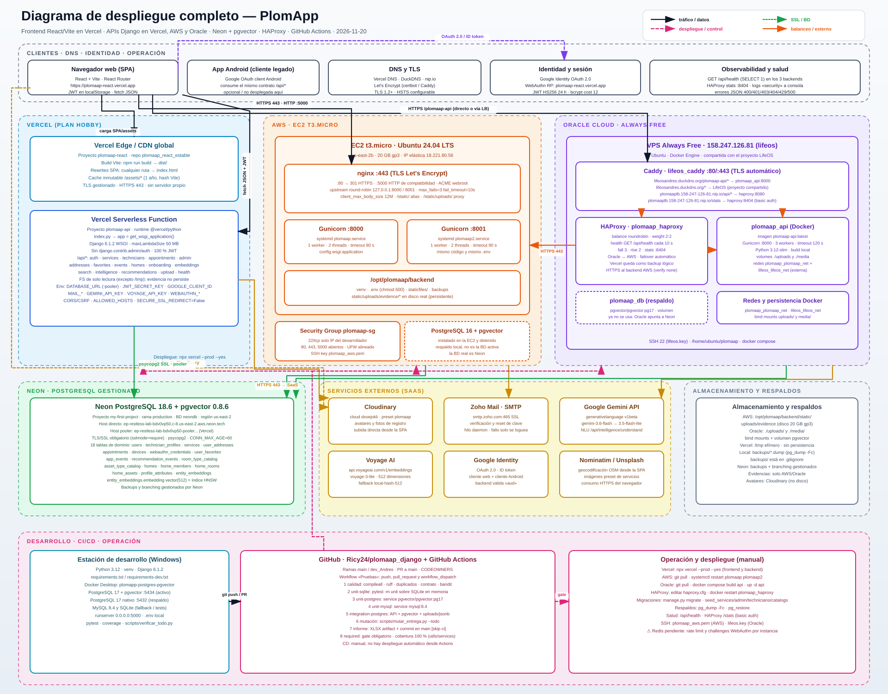

# Diagrama de despliegue completo — PlomApp

> **Fecha de corte:** 2026-11-20  
> **Alcance:** todo lo que existe hoy para ejecutar PlomApp: frontend React, backend Django, los tres backends de producción, el balanceador global, la base Neon, los servicios externos, el almacenamiento, el entorno local y el pipeline de CI/CD.  
> **Naturaleza:** diagrama de **despliegue** (qué artefacto corre en qué nodo, con qué puertos, protocolos y dependencias), no un diagrama de clases ni de secuencia.

**Archivos de este diagrama**

| Archivo | Uso |
|---|---|
| [`diagrama_despliegue.svg`](diagrama_despliegue.svg) | Diagrama maestro visual, 1920 × 1500, vectorial |
| [`diagrama_despliegue.mmd`](diagrama_despliegue.mmd) | Fuente Mermaid editable (GitHub, VS Code, mermaid.live) |
| `DIAGRAMA_DESPLIEGUE.md` | Este documento: inventario, puertos, flujos, operación y riesgos |

**Fuentes verificadas:** `README.md`, `config/settings.py`, `config/urls.py`, `config/wsgi.py`, `index.py`, `vercel.json`, `.vercelignore`, `docker-compose.yml`, `.env.example`, `requirements.txt`, `docs/despliegue/DESPLIEGUE_COMPLETO.md`, `docs/despliegue/aws/*`, `docs/despliegue/vercel/*`, `.github/workflows/pruebas.yml`, `api/models.py`, `api/urls.py`, `api/views/*`, `api/services/*`, `api/utils/*`.

---

## 1. Diagrama maestro



**Cómo leerlo**

- Cada **zona punteada** es un nodo de despliegue (Vercel, AWS, Oracle, Neon, SaaS, almacenamiento, desarrollo, CI/CD).
- Cada **caja** es un artefacto o componente desplegado dentro de ese nodo.
- Las flechas negras son tráfico de usuarios; las verdes, conexiones a base de datos; las naranjas, balanceo o servicios externos; las rosas punteadas, despliegue/control; las violetas punteadas, identidad.
- El diagrama muestra el **estado documentado**, no una maqueta ideal. Las diferencias y deudas técnicas están en la sección 12.

---

## 2. Resumen ejecutivo

PlomApp es una **API headless Django** con un **frontend React/Vite separado**. El mismo código Django se ejecuta de tres formas distintas:

1. **Vercel Serverless** (`plomaap-api`): función Python que envuelve WSGI con `index.py`.
2. **AWS EC2** (`plomaap.duckdns.org`): nginx con TLS y dos procesos Gunicorn (`:8000` y `:8001`) en round-robin.
3. **Oracle Cloud** (`lifeosandres.duckdns.org/plomaap-api`): Docker + Caddy + Gunicorn (`:8000`, 3 workers), compartiendo VPS con LifeOS.

Los tres backends apuntan a la **misma base Neon** (PostgreSQL 18.6 + pgvector 0.8.6). El balanceador global **HAProxy** corre en Oracle y reparte tráfico entre Oracle y AWS, con health checks activos y failover. Vercel queda como backup lógico documentado.

El **frontend desplegado** consume por defecto `https://plomaap-api.vercel.app` (`VITE_API_URL`), no el balanceador global. El LB global se usa cuando un cliente apunta explícitamente a `https://plomaaplb.158-247-126-81.nip.io/api`.

| Capa | Plataforma | Costo | Estado |
|---|---|---|---|
| Frontend React + Vite | Vercel Hobby (CDN global) | Gratis | ✅ En vivo |
| API principal serverless | Vercel Hobby (`@vercel/python`) | Gratis | ✅ En vivo |
| API respaldo con balanceo | AWS EC2 `t3.micro` + nginx + 2 Gunicorn | Free tier 12 meses | ✅ En vivo |
| API Oracle | Oracle Cloud Always Free + Docker + Caddy | Gratis permanente | ✅ En vivo |
| Balanceador global | HAProxy en VPS Oracle | Gratis | ✅ En vivo |
| Base de datos | Neon Free: PostgreSQL 18.6 + pgvector 0.8.6 | Gratis | ✅ En vivo |
| DNS | Vercel DNS + DuckDNS + nip.io | Gratis | ✅ |
| TLS | Vercel / Let's Encrypt (certbot y Caddy) | Gratis | ✅ |
| CI | GitHub Actions (7 jobs + gate) | Gratis | ✅ |
| Almacenamiento de evidencias | Disco AWS / bind mounts Oracle | Incluido | ✅ |
| Avatares e imágenes | Cloudinary | Gratis | ✅ |

---

## 3. Inventario de nodos de despliegue

### 3.1 Clientes y acceso

| ID | Nodo | Plataforma / artefacto | Red / puertos | Notas |
|---|---|---|---|---|
| C1 | Navegador web | SPA React + Vite, React Router, JWT en `localStorage` | HTTPS 443 saliente | Consume CDN, API y servicios externos |
| C2 | App Android (opcional) | Cliente legado con Google OAuth Android | HTTPS 443 | No está desplegada en este repositorio; usa el mismo contrato `/api/*` |
| C3 | DNS + TLS | Vercel DNS, DuckDNS, nip.io, Let's Encrypt | 53, 80, 443 | Dominios en la sección 5 |
| C4 | Identidad y sesión | Google Identity OAuth 2.0, WebAuthn, JWT HS256 | HTTPS 443 | `WEBAUTHN_RP_ID=plomaap-react.vercel.app` en Vercel |
| C5 | Observabilidad | `/api/health`, HAProxy stats, logs `security` | HTTPS 443 / 8404 | Errores siempre JSON |

### 3.2 Vercel

| ID | Nodo | Plataforma / artefacto | Red / puertos | Notas |
|---|---|---|---|---|
| V1 | Vercel Edge / CDN | Proyecto `plomaap-react`, build `npm run build` → `dist/` | HTTPS 443 | `vercel.json` con rewrites SPA y cache inmutable de `/assets/*` |
| V2 | Vercel Serverless Function | Proyecto `plomaap-api`, `@vercel/python`, `index.py` → Django WSGI | HTTPS 443 | `maxLambdaSize: 50mb`; FS de solo lectura salvo `/tmp`; usa Neon `-pooler` |

**Variables clave de V2:** `DATABASE_URL` (host `-pooler`), `JWT_SECRET_KEY`, `SECRET_KEY`, `DEBUG=False`, `ALLOWED_HOSTS`, `CORS_ORIGINS`, `CSRF_TRUSTED_ORIGINS`, `GOOGLE_CLIENT_ID`, `MAIL_*`, `GEMINI_API_KEY`, `VOYAGE_API_KEY`, `WEBAUTHN_*`, `USE_X_FORWARDED_PROTO=True`, `SECURE_SSL_REDIRECT=False`.

### 3.3 AWS

| ID | Nodo | Plataforma / artefacto | Red / puertos | Notas |
|---|---|---|---|---|
| A1 | EC2 | `t3.micro`, Ubuntu 24.04 LTS, us-east-2b, 20 GB gp3, IP elástica `18.221.80.56` | 22, 80, 443, 5000 | Cuenta AWS `433306738256`, instancia `i-02ff7ac21f7d6d155` |
| A2 | nginx | `:443` TLS Let's Encrypt; `:80` redirección/ACME; `:5000` compatibilidad | 80, 443, 5000 | Upstream round-robin `127.0.0.1:8000` y `:8001`; `max_fails=3`, `fail_timeout=10s`; `client_max_body_size 12M` |
| A3 | Gunicorn :8000 | `systemd` `plomaap.service`; 1 worker, 2 threads, timeout 90 s | 127.0.0.1:8000 | `config.wsgi:application` |
| A4 | Gunicorn :8001 | `systemd` `plomaap2.service`; 1 worker, 2 threads, timeout 90 s | 127.0.0.1:8001 | Mismo código y `.env` |
| A5 | Disco / estáticos | `/opt/plomaap/backend`: `venv`, `.env` (600), `staticfiles/`, `static/uploads/evidence/` | FS local | Evidencias persistentes; nginx sirve `/static/` |
| A6 | Security Group | `plomaap-sg` / `sg-0d01b48cf62cff454` | 22 (`181.32.211.255/32`), 80, 443, 5000 | UFW alineado |
| A7 | PostgreSQL 16 + pgvector | Instalado en la EC2 y **detenido** | 5432 local | Respaldo local; la BD activa es Neon |

### 3.4 Oracle Cloud

| ID | Nodo | Plataforma / artefacto | Red / puertos | Notas |
|---|---|---|---|---|
| O1 | VPS Always Free | `158.247.126.81`, hostname `lifeos`, Ubuntu, Docker Engine | 22, 80, 443 | Compartida con LifeOS; SSH `lifeos.key`; ruta `/home/ubuntu/plomaap` |
| O2 | Caddy | Contenedor `lifeos_caddy`, `caddy:2-alpine`, TLS automático | 80, 443 | Enruta `/plomaap-api/*` a `plomaap_api:8000`, raíz a LifeOS, LB a HAProxy |
| O3 | HAProxy | Contenedor `plomaap_haproxy` | 8080 API, 8404 stats | Round-robin Oracle/AWS, pesos 2:2, health `/api/health` cada 10 s, `fall 3`, `rise 2` |
| O4 | API Oracle | Contenedor `plomaap_api`, imagen `plomaap-api:latest` | 8000 interno | Python 3.12-slim, Gunicorn 3 workers, timeout 120 s, volúmenes `uploads/` y `media/` |
| O5 | Base local de respaldo | Contenedor `plomaap_db`, `pgvector/pgvector:pg17` | 5432 interno | **Ya no se usa**: Oracle apunta a Neon; queda como respaldo |
| O6 | Redes Docker | `plomaap_plomaap_net` + `lifeos_lifeos_net` (externa) | Interna | Caddy alcanza el contenedor por la red externa |

**Rutas de Caddy**

```caddyfile
lifeosandres.duckdns.org {
    handle_path /plomaap-api/* { reverse_proxy plomaap_api:8000 }
    handle { reverse_proxy api:8000 }   # LifeOS
}

plomaaplb.158-247-126-81.nip.io {
    handle /stats* { basic_auth { admin ... } reverse_proxy plomaap_haproxy:8404 }
    handle /api/*  { reverse_proxy plomaap_haproxy:8080 }
    handle { respond "PlomApp Global Load Balancer" 200 }
}
```

### 3.5 Base de datos

| ID | Nodo | Plataforma / artefacto | Red / puertos | Notas |
|---|---|---|---|---|
| D1 | Neon PostgreSQL | PostgreSQL 18.6 + pgvector 0.8.6, proyecto `my-first-project`, rama `production`, BD `neondb` | 5432 SSL | `us-east-2`; host directo y host `-pooler`; 18 tablas; `vector(512)` + HNSW; backups y branching gestionados |

- **AWS y Oracle** usan el **host directo**.
- **Vercel** usa el **host `-pooler`** para no agotar conexiones con invocaciones serverless.
- `sslmode=require`; `CONN_MAX_AGE=60` en la configuración Django.

### 3.6 Servicios externos (SaaS)

| ID | Servicio | Uso | Protocolo | Notas |
|---|---|---|---|---|
| S1 | Cloudinary | Avatares y fotos de registro | HTTPS 443 | Cloud `dxoejokli`, preset `plomaap`; subida directa desde la SPA |
| S2 | Zoho Mail SMTP | Verificación de correo y reset de contraseña | SMTP SSL 465 | `smtp.zoho.com`; envío en hilo daemon; fallo solo se registra |
| S3 | Google Gemini API | NLU de `/api/intelligence/understand` | HTTPS 443 | `generativelanguage.googleapis.com/v1beta`; `gemini-3.6-flash` → `gemini-3.5-flash-lite`; fallback local determinista |
| S4 | Voyage AI | Embeddings de 512 dimensiones | HTTPS 443 | `api.voyageai.com/v1/embeddings`; `voyage-3-lite`; fallback `local-hash-512` |
| S5 | Google Identity | Login con Google | HTTPS 443 | Cliente web (`...v932...`) y Android (`...c94r...`); el backend valida `aud` |
| S6 | Nominatim / Unsplash | Geocodificación y imágenes preset | HTTPS 443 | Consumo desde la SPA; no pasa por Django |

### 3.7 Almacenamiento y respaldos

| ID | Nodo | Contenido | Persistencia |
|---|---|---|---|
| ST1 | Disco AWS | `/opt/plomaap/backend/static/uploads/evidence/*` | Disco EBS 20 GB gp3 |
| ST2 | Volúmenes Oracle | `./uploads/` y `./media/` (bind mounts) + volumen de `plomaap_db` | Disco del VPS |
| ST3 | Vercel `/tmp` | Archivos temporales de la función | Efímero; no persistente |
| ST4 | Respaldos | `backups/*.dump` local (`pg_dump -Fc`) + backups gestionados de Neon | Local, `backups/` en `.gitignore` |

### 3.8 Desarrollo, CI/CD y operación

| ID | Nodo | Plataforma / artefacto | Notas |
|---|---|---|---|
| L1 | Estación de desarrollo | Windows, Python 3.12, `venv`, Django 6.1.2 | `runserver 0.0.0.0:5000`; `pytest`, `coverage`, `scripts/verificar_todo.py` |
| L2 | PostgreSQL de desarrollo | Docker `plomapp-postgres-pgvector`, `pgvector/pgvector:pg17`, `localhost:5434` | Base activa de desarrollo; volumen externo `plomaap_pgvector_data` |
| L3 | PostgreSQL nativo | `localhost:5432` | Respaldo sin pgvector, datos anteriores |
| L4 | MySQL 8.4 | Fallback / CI | `PyMySQL`; pruebas en CI |
| L5 | SQLite | Fallback / tests en memoria | Suite unitaria por defecto |
| G1 | GitHub backend | `Ricy24/plomaap_django`, ramas `main` / `dev_Andres` | PR, CODEOWNERS |
| G2 | GitHub frontend | `plomaap_react_estable` | Repositorio separado; despliegue manual con Vercel CLI |
| G3 | GitHub Actions | Workflow `Pruebas` | 7 jobs + `required`; ver sección 11 |
| G4 | Artefactos | `coverage.xml`, XLSX de entrega | `upload-artifact`; commit en `main` con `GIT_PUSH_TOKEN` |
| OP1 | Operación | Vercel CLI, SSH, systemd, Docker Compose, migraciones, backups | Despliegue **manual**, sin CD automático |

---

## 4. Matriz de conexiones y puertos

| # | Origen → Destino | Puerto / protocolo | Cifrado | Para qué |
|---|---|---|---|---|
| 1 | Navegador → Vercel Edge | 443 / HTTPS | TLS Vercel | Descargar SPA, assets y `index.html` |
| 2 | Navegador → Vercel API | 443 / HTTPS | TLS Vercel | `fetch` JSON + JWT a `/api/*` |
| 3 | Navegador → AWS nginx | 443 / HTTPS; 5000 / HTTP | TLS / sin TLS en 5000 | API de respaldo y compatibilidad |
| 4 | Navegador → Oracle Caddy | 443 / HTTPS | TLS Caddy | `/plomaap-api/api/*` |
| 5 | Navegador → Caddy (LB global) | 443 / HTTPS | TLS Caddy | `/api/*` y `/stats` vía `plomaaplb...nip.io` |
| 6 | Navegador → Cloudinary | 443 / HTTPS | TLS | Subida directa de avatares/fotos |
| 7 | Navegador → Google Identity | 443 / HTTPS | TLS | OAuth 2.0 / ID token |
| 8 | Navegador → Nominatim / Unsplash | 443 / HTTPS | TLS | Geocodificación e imágenes |
| 9 | Caddy → `plomaap_api` | 8000 / HTTP | Red Docker | API Oracle |
| 10 | Caddy → HAProxy | 8080 / HTTP; 8404 / HTTP | Red Docker | API global y stats con basic auth |
| 11 | HAProxy → `plomaap_api` | 8000 / HTTP | Red Docker | Backend Oracle local |
| 12 | HAProxy → AWS nginx | 443 / HTTPS `verify none` | TLS | Backend AWS; health `/api/health` cada 10 s |
| 13 | HAProxy → Vercel API | 443 / HTTPS | TLS | Backup lógico documentado; la cfg incluida solo declara Oracle y AWS |
| 14 | AWS nginx → Gunicorn :8000 | 8000 / HTTP | Loopback | Round-robin |
| 15 | AWS nginx → Gunicorn :8001 | 8001 / HTTP | Loopback | Round-robin |
| 16 | AWS nginx → disco | FS local | N/A | `/static/` alias y `/static/uploads/` proxy |
| 17 | Vercel API → Neon | 5432 / PostgreSQL | SSL `require` | Host `-pooler` |
| 18 | AWS Gunicorn → Neon | 5432 / PostgreSQL | SSL `require` | Host directo |
| 19 | Oracle API → Neon | 5432 / PostgreSQL | SSL `require` | Host directo |
| 20 | Oracle API → `plomaap_db` | 5432 / PostgreSQL | Red Docker | Respaldo no usado |
| 21 | APIs → Zoho SMTP | 465 / SMTP SSL | TLS | Verificación y reset |
| 22 | APIs → Gemini | 443 / HTTPS | TLS | NLU |
| 23 | APIs → Voyage | 443 / HTTPS | TLS | Embeddings |
| 24 | APIs → Google Identity | 443 / HTTPS | TLS | Validación de ID token / certs |
| 25 | AWS nginx → Let's Encrypt | 80 / HTTP (ACME) | N/A | Emisión y renovación |
| 26 | Caddy → Let's Encrypt | 80/443 | TLS | Emisión y renovación automática |
| 27 | Desarrollador → GitHub | 443 / HTTPS o 22 / SSH | TLS/SSH | `git push`, PR |
| 28 | Desarrollador → Vercel CLI | 443 / HTTPS | TLS | `npx vercel --prod --yes` |
| 29 | Desarrollador → AWS EC2 | 22 / SSH | SSH | `plomaap_aws.pem` |
| 30 | Desarrollador → Oracle VPS | 22 / SSH | SSH | `lifeos.key` |
| 31 | GitHub Actions → PostgreSQL service | 5432 | Interno CI | `pgvector/pgvector:pg17` |
| 32 | GitHub Actions → MySQL service | 3306 | Interno CI | `mysql:8.4` |
| 33 | GitHub Actions → artefactos | Interno | N/A | `coverage.xml`, XLSX |
| 34 | `plomaap_api` → volúmenes | FS | N/A | `uploads/`, `media/` |
| 35 | Neon → respaldos | Interno | N/A | Backups gestionados |

> **Precisión:** en AWS la conexión a Neon la abren los procesos **Gunicorn**, no nginx. En el diagrama visual la flecha sale de la zona AWS para no cruzar la caja de nginx; en esta matriz queda explícito.

---

## 5. DNS, dominios y TLS

| Dominio | Proveedor | Apunta a | TLS |
|---|---|---|---|
| `plomaap-react.vercel.app` | Vercel | CDN de Vercel | Gestionado por Vercel |
| `plomaap-api.vercel.app` | Vercel | Función serverless | Gestionado por Vercel |
| `plomaap.duckdns.org` | DuckDNS | `18.221.80.56` (AWS) | Let's Encrypt / certbot |
| `18-221-80-56.nip.io` | nip.io | `18.221.80.56` (AWS) | Let's Encrypt / certbot |
| `lifeosandres.duckdns.org` | DuckDNS | `158.247.126.81` (Oracle) | Caddy automático |
| `plomaaplb.158-247-126-81.nip.io` | nip.io | `158.247.126.81` (Oracle) | Caddy automático |
| `localhost:5000` | Local | Django `runserver` | HTTP |
| `localhost:5434` | Local | Contenedor pgvector | PostgreSQL |

**URLs de producción**

| Servicio | URL |
|---|---|
| Frontend | https://plomaap-react.vercel.app |
| API Vercel | https://plomaap-api.vercel.app/api |
| Health Vercel | https://plomaap-api.vercel.app/api/health |
| API AWS | https://plomaap.duckdns.org/api |
| Health AWS | https://plomaap.duckdns.org/api/health |
| Dominio alterno AWS | https://18-221-80-56.nip.io/api |
| HTTP directo AWS | http://18.221.80.56:5000/api |
| API Oracle | https://lifeosandres.duckdns.org/plomaap-api/api |
| Health Oracle | https://lifeosandres.duckdns.org/plomaap-api/api/health |
| API LB global | https://plomaaplb.158-247-126-81.nip.io/api |
| Health LB global | https://plomaaplb.158-247-126-81.nip.io/api/health |
| Stats HAProxy | https://plomaaplb.158-247-126-81.nip.io/stats |

---

## 6. Artefactos desplegados y rutas

### Backend (este repositorio)

```text
backend_plomaap/
├── index.py                  # entrypoint WSGI para Vercel
├── vercel.json               # build @vercel/python + route /(.*) → index.py
├── .vercelignore             # excluye tests, docs, backups, pyproject.toml...
├── manage.py                 # CLI Django
├── requirements.txt          # dependencias de ejecución
├── requirements-dev.txt      # pytest, ruff, coverage, bandit...
├── docker-compose.yml        # PostgreSQL 17 + pgvector para desarrollo
├── config/                   # settings, urls, wsgi, asgi
├── api/                      # models, views, controllers, services, utils
│   ├── templates/emails/     # plantillas de correo
│   └── tests/                # unit + integration
├── static/uploads/           # evidencias (se sirven en /static/uploads/...)
├── docs/despliegue/          # guías AWS, Vercel, Oracle, HAProxy
├── scripts/                  # verificación, mutación, informe
└── .github/workflows/        # CI
```

### AWS

```text
/opt/plomaap/backend/
├── venv/
├── .env                      # chmod 600
├── staticfiles/
├── static/uploads/evidence/
└── ...
/etc/systemd/system/plomaap.service
/etc/systemd/system/plomaap2.service
/etc/nginx/sites-available/plomaap
/etc/letsencrypt/live/18-221-80-56.nip.io/
```

### Oracle

```text
/home/ubuntu/plomaap/
├── docker-compose.yml        # db + api + haproxy (y Caddy compartido)
├── Dockerfile                # python:3.12-slim + gunicorn
├── .env                      # variables de producción
├── uploads/                  # evidencias (bind mount)
├── media/
├── backend/                  # git clone del backend
└── haproxy/haproxy.cfg
```

### Vercel

- **Frontend (`plomaap-react`)**: `plomaap_react_estable`, `vercel.json` con `framework: vite`, `outputDirectory: dist`, rewrites SPA, cache de assets.
- **Backend (`plomaap-api`)**: raíz de este repositorio, `index.py`, `vercel.json`, `.vercelignore`. Vercel instala desde `requirements.txt` porque `pyproject.toml` está excluido.

---

## 7. Modelo de datos desplegado

Neon contiene **18 tablas de dominio** (esquema 1:1 con Flask/SQLAlchemy, sin tablas de `auth`/`admin`), más las tablas internas de Django (`django_migrations`, `django_content_type`):

| Grupo | Tablas | Uso |
|---|---|---|
| Identidad | `users`, `devices`, `webauthn_credentials`, `profile_attributes` | Usuarios, dispositivos, passkeys, atributos de perfil |
| Catálogos | `services`, `room_type_catalog`, `asset_type_catalog`, `technician_profiles` | Servicios, tipos de habitación/activo, técnicos |
| Agenda | `appointments`, `user_addresses`, `user_favorites` | Citas, direcciones, favoritos |
| Hogares | `homes`, `home_members`, `home_rooms`, `home_assets` | Hogares, miembros, habitaciones, activos |
| Analítica / IA | `app_events`, `recommendation_events`, `entity_embeddings` | Eventos, recomendaciones, embeddings |

Detalles relevantes:

- `appointments.evidence_photos` es **`jsonb`** (migración 0003; Flask lo creó como `json`).
- `entity_embeddings.embedding` es **`vector(512)`** con índice **HNSW** `idx_entity_embeddings_vector`.
- `users` guarda hashes **bcrypt cost 12**.
- `webauthn_credentials` soporta passkeys.
- En SQLite/MySQL de tests no hay pgvector real: la aplicación usa el fallback de texto/coseno en Python y las pruebas de integración con pgvector corren contra PostgreSQL.

---

## 8. Flujos de extremo a extremo

### 8.1 Carga de la SPA

1. El navegador pide `https://plomaap-react.vercel.app`.
2. Vercel Edge devuelve `index.html` y assets de Vite (hash, cache inmutable).
3. React Router resuelve rutas como `/admin`, `/ingresar`, etc.
4. La SPA lee `VITE_API_URL` (por defecto `https://plomaap-api.vercel.app`) y hace `fetch` JSON con JWT.

### 8.2 Login y sesión

1. `POST /api/auth/login` con `{email, password, role}`.
2. Django busca el usuario en Neon, compara **bcrypt** y verifica que esté activo.
3. Emite **JWT HS256** con `sub` como string, expiración 24 h (`JWT_EXPIRATION_HOURS`).
4. El frontend guarda el token en `localStorage` (`authToken`) y lo envía en `Authorization: Bearer ...`.
5. Google: el frontend obtiene un ID token; el backend valida `aud` contra `GOOGLE_CLIENT_ID`.
6. Passkeys: `POST /api/auth/passkey/{register,login}/{options,verify}` con WebAuthn; los challenges viven **en memoria** (`CHALLENGES`) y expiran a los 5 minutos.

### 8.3 Petición a la API de Vercel

1. Vercel invoca `index.py` → `get_wsgi_application()`.
2. Middleware: CORS → seguridad → common → `JSONErrorMiddleware` → `SecurityLoggingMiddleware`.
3. `api/urls.py` despacha por método HTTP (405 JSON si no coincide).
4. La vista llama a `api/services/*` y al ORM/SQL parametrizado.
5. psycopg2 conecta a Neon por el host **`-pooler`** con SSL.
6. Respuesta JSON; errores 400/401/403/404/429/500 siempre JSON.

### 8.4 Petición a AWS

1. DNS resuelve `plomaap.duckdns.org` → `18.221.80.56`.
2. nginx termina TLS en `:443` (o `:5000` HTTP de compatibilidad).
3. `upstream plomaap_backend` reparte round-robin entre `:8000` y `:8001`.
4. Gunicorn ejecuta `config.wsgi:application` con el `.env` de `/opt/plomaap/backend`.
5. Conexión directa a Neon con SSL; evidencias en disco local.
6. nginx sirve `/static/` desde `staticfiles/` y proxya `/static/uploads/`.

### 8.5 Petición a Oracle

1. Caddy recibe `https://lifeosandres.duckdns.org/plomaap-api/...`.
2. `handle_path` recorta `/plomaap-api` y reenvía a `plomaap_api:8000`.
3. Gunicorn (3 workers) ejecuta el mismo Django.
4. Conexión directa a Neon; `uploads/` y `media/` en bind mounts.
5. La raíz del dominio sigue siendo LifeOS; PlomApp vive bajo el prefijo.

### 8.6 Balanceador global y failover

1. Cliente pide `https://plomaaplb.158-247-126-81.nip.io/api/...`.
2. Caddy termina TLS y reenvía `/api/*` a `plomaap_haproxy:8080`.
3. HAProxy reparte round-robin entre:
   - `plomaap_api:8000` (Oracle, peso 2)
   - `plomaap.duckdns.org:443` (AWS, peso 2, SSL verify none)
4. Health check `GET /api/health` cada 10 s; `fall 3`, `rise 2`.
5. Si un backend cae, el tráfico va al otro. Vercel queda como backup lógico documentado (no está en la cfg mostrada).
6. Stats en `:8404`, publicadas por Caddy en `/stats` con basic auth.

### 8.7 Subida de archivos

- **Avatares / registro:** la SPA sube directo a **Cloudinary** con `VITE_CLOUDINARY_CLOUD_NAME=dxoejokli` y `VITE_CLOUDINARY_UPLOAD_PRESET=plomaap`.
- **Evidencias de citas:** `POST /api/upload/evidence` guarda en disco. Funciona en **AWS** y **Oracle**; en **Vercel** el FS es de solo lectura (salvo `/tmp`), así que no persiste.
- Validación: extensión en lista blanca, firma binaria real, nombre UUID y máximo 10 MB.

### 8.8 IA, embeddings y búsqueda

1. `POST /api/embeddings/embed` → Voyage AI (`voyage-3-lite`, 512 dims); si no hay clave, fallback `local-hash-512`.
2. `POST /api/embeddings/sync` guarda en `entity_embeddings`.
3. `POST /api/search/hybrid` combina texto + similitud; con pgvector usa `<=>` y `CAST(... AS vector)`, si no hay pgvector cae a coseno en Python.
4. `POST /api/intelligence/understand` llama a Gemini (`gemini-3.6-flash` → `gemini-3.5-flash-lite`); si falla, usa reglas locales deterministas y valida contra la BD real.

### 8.9 Correo

1. Registro, verificación y reset generan un correo con plantilla Django.
2. `email_utils` envía en un **hilo daemon** (`async_send=True`) por `smtp.zoho.com:465` SSL.
3. Un fallo SMTP se registra; no rompe la petición.

### 8.10 CI

1. Push a `main`/`dev_Andres` o PR a `main` dispara `.github/workflows/pruebas.yml`.
2. `calidad`: `compileall`, `ruff`, duplicados, contrato de entregas, `bandit`.
3. `unit-sqlite`: suite unitaria en SQLite en memoria.
4. `unit-postgres`: servicio `pgvector/pgvector:pg17`.
5. `unit-mysql`: servicio `mysql:8.4`.
6. `integration-postgres`: integración + contrato contra pgvector.
7. `mutacion`: `scripts/mutar_entrega.py --todo`.
8. `informe`: genera XLSX, lo publica como artefacto y, en `main`, lo commitea con `[skip ci]`.
9. `required`: gate que exige que todos los jobs anteriores pasen. Cobertura mínima 100 % sobre `api/utils` + `api/services`.

### 8.11 Despliegue

No hay CD automático desde GitHub Actions. El despliegue es **manual**:

- **Vercel frontend:** `npx vercel --prod --yes` en `plomaap_react_estable`.
- **Vercel backend:** `npx vercel --prod --yes` en `backend_plomaap`.
- **AWS:** `git pull` + `migrate` + `systemctl restart plomaap plomaap2`.
- **Oracle:** `git pull` + `docker compose build api` + `docker compose up -d api`.
- **HAProxy:** editar `haproxy.cfg` + `docker restart plomaap_haproxy`.

---

## 9. Variables de entorno por destino

| Variable / grupo | Local | Vercel API | AWS | Oracle | Frontend Vercel |
|---|---|---|---|---|---|
| `SECRET_KEY`, `JWT_SECRET_KEY` | `.env` local | Secretos de Vercel | `.env` 600 | `.env` | No |
| `DEBUG` | `True` | `False` | `False` | `False` | N/A |
| `ALLOWED_HOSTS` | `*` o local | `.vercel.app`, dominios | Dominios AWS | Dominios Oracle | N/A |
| `DATABASE_URL` | Postgres local o `DATABASE_URL` | Neon `-pooler` | Neon directo | Neon directo | N/A |
| `PGSSLMODE` | Opcional | `require` | `require` | `require` | N/A |
| `CORS_ALLOW_ALL_ORIGINS` / `CORS_ORIGINS` | Abierto en dev | Configurado | Configurado | Configurado | N/A |
| `CSRF_TRUSTED_ORIGINS` | Local | Dominios Vercel/AWS | Dominios AWS | Dominios Oracle | N/A |
| `GOOGLE_CLIENT_ID` | Opcional | Cliente web | Cliente Android | Según configuración | `VITE_GOOGLE_CLIENT_ID` |
| `MAIL_*` | Opcional | Zoho | Zoho | Zoho | N/A |
| `GEMINI_API_KEY`, `VOYAGE_API_KEY`, `EMBEDDING_*` | Opcional | Sí | Sí | Sí | N/A |
| `WEBAUTHN_RP_ID`, `WEBAUTHN_ORIGIN` | `localhost` | `plomaap-react.vercel.app` | Según dominio | Según dominio | N/A |
| `USE_X_FORWARDED_PROTO` | `False` | `True` | `True` | `True` | N/A |
| `SECURE_SSL_REDIRECT` | `False` | `False` | `True` (recomendado) | `True` (recomendado) | N/A |
| `VITE_API_URL` | `http://localhost:5000` | N/A | N/A | N/A | `https://plomaap-api.vercel.app` |
| `VITE_GEOCODING_API`, `VITE_CLOUDINARY_*` | Opcional | N/A | N/A | N/A | Producción |

> Las variables de Vite se **hornean en el bundle** durante el build: si cambias `VITE_API_URL`, hay que redeployar el frontend.

---

## 10. Seguridad desplegada

- **Contraseñas:** bcrypt cost 12, compatible con los hashes existentes.
- **Sesiones:** JWT HS256 firmados con `JWT_SECRET_KEY`; se valida firma, expiración, usuario existente y `active`; roles con decoradores (`admin_only`, `technician_only`, etc.).
- **Passkeys:** WebAuthn; `RP_ID` debe coincidir con el dominio del frontend.
- **SQL:** ORM y SQL crudo con parámetros enlazados (pgvector, recomendaciones).
- **Subidas:** lista blanca, firma binaria, UUID, máximo 10 MB.
- **CORS/CSRF:** configurables; en producción conviene `CORS_ALLOW_ALL_ORIGINS=False` y `CORS_ORIGINS` explícito.
- **Orígenes JS de Google:** `http://localhost:5173`, `http://localhost:3000`, `https://plomaap-react.vercel.app`, `https://plomaap.duckdns.org`.
- **TLS:** Vercel gestionado, AWS Let's Encrypt/certbot, Oracle Caddy automático.
- **Cabeceras:** `X_FRAME_OPTIONS=DENY`, `SECURE_CONTENT_TYPE_NOSNIFF`, `SECURE_REFERRER_POLICY=same-origin`, HSTS configurable.
- **Secretos:** `.env` fuera de Git; en Vercel, variables cifradas. `.env.example` solo tiene placeholders.
- **Sin panel admin:** no se instala `django.contrib.admin` ni `auth`; toda la autenticación es JWT. Esto reduce superficie de ataque.
- **Errores:** siempre JSON, sin trazas internas al cliente.
- **Rate limiting:** decorador `rate_limit` con cache; hoy `LocMemCache` por proceso (ver limitaciones).
- **Logs:** logger `security` para 401/403/404/429/500.

---

## 11. Operación: despliegue, salud y respaldos

### 11.1 Desplegar frontend (Vercel)

```powershell
cd C:\Users\Anrid\plomaap_react_estable
git pull
npx vercel --prod --yes
```

### 11.2 Desplegar backend (Vercel)

```powershell
cd C:\Users\Anrid\backend_plomaap
git pull
npx vercel --prod --yes
```

### 11.3 Actualizar AWS

```bash
ssh -i ~/.ssh/plomaap_aws.pem ubuntu@18.221.80.56
cd /opt/plomaap/backend
git pull origin main
./venv/bin/python manage.py migrate
sudo systemctl restart plomaap plomaap2
sudo nginx -t && sudo systemctl reload nginx
curl -sS https://plomaap.duckdns.org/api/health; echo
```

### 11.4 Actualizar Oracle

```bash
ssh -i ~/.ssh/lifeos.key ubuntu@lifeosandres.duckdns.org
cd /home/ubuntu/plomaap/backend
git pull origin main
cd /home/ubuntu/plomaap
docker compose build api
docker compose up -d api
curl -sS https://lifeosandres.duckdns.org/plomaap-api/api/health; echo
```

### 11.5 Actualizar HAProxy

```bash
ssh -i ~/.ssh/lifeos.key ubuntu@lifeosandres.duckdns.org
nano /home/ubuntu/plomaap/haproxy/haproxy.cfg
docker restart plomaap_haproxy
docker logs plomaap_haproxy --tail 30
```

### 11.6 Migraciones y seeds

```powershell
# Base existente (tablas creadas por Flask)
python manage.py migrate api 0001 --fake
python manage.py migrate api 0002 --fake
python manage.py migrate

# Base nueva
python manage.py migrate
python manage.py seed
# o individuales:
python manage.py seed_services
python manage.py seed_admin
python manage.py seed_technicians
python manage.py seed_catalogs
```

### 11.7 Salud y verificación

```bash
curl -sS https://plomaap-api.vercel.app/api/health
curl -sS https://plomaap.duckdns.org/api/health
curl -sS https://lifeosandres.duckdns.org/plomaap-api/api/health
curl -sS https://plomaaplb.158-247-126-81.nip.io/api/health
curl -sS https://plomaaplb.158-247-126-81.nip.io/stats
```

Respuesta esperada de `/api/health`:

```json
{
  "status": "healthy",
  "timestamp": "2026-11-20T...",
  "database": "connected"
}
```

### 11.8 Respaldos

```powershell
$env:PGPASSWORD='<password>'
& 'C:\Program Files\PostgreSQL\17\bin\pg_dump.exe' `
    -h localhost -p 5434 -U postgres -d plomapp `
    -Fc -f backups\plomapp_$(Get-Date -Format yyyyMMdd_HHmmss).dump
```

Restauración en base nueva:

```powershell
& 'C:\Program Files\PostgreSQL\17\bin\createdb.exe' -h localhost -p 5434 -U postgres plomapp_restore
& 'C:\Program Files\PostgreSQL\17\bin\pg_restore.exe' -h localhost -p 5434 -U postgres `
    -d plomapp_restore --no-owner backups\plomapp_YYYYMMDD_HHMMSS.dump
```

- `backups/` está en `.gitignore`.
- Neon tiene backups y branching gestionados.
- Las evidencias de AWS/Oracle no están incluidas en el `pg_dump`; si se necesita recuperación completa, hay que respaldar también `static/uploads/evidence/` y los bind mounts.

### 11.9 Rollback rápido

- **Vercel:** promover el deployment anterior desde el dashboard o `vercel rollback`.
- **AWS:** `git checkout <commit>` + `systemctl restart plomaap plomaap2`.
- **Oracle:** `git checkout <commit>` + `docker compose build api && docker compose up -d api`.
- **HAProxy:** restaurar `haproxy.cfg` anterior + `docker restart plomaap_haproxy`.
- **BD:** restaurar dump o usar el branching de Neon; nunca probar restores sobre la base activa.

---

## 12. Limitaciones, riesgos y deudas técnicas

Estas observaciones son importantes para que el diagrama no dé una falsa sensación de “todo resuelto”:

1. **Challenges WebAuthn en memoria.** `api/controllers/passkey_controller.py` usa `CHALLENGES = {}`. Con varios workers/procesos (AWS tiene 2 Gunicorn; Oracle, 3 workers; Vercel, múltiples lambdas) las opciones y la verificación pueden caer en procesos distintos y fallar. Se recomienda Redis o almacenamiento compartido. El propio README lo advierte.
2. **Rate limiting por proceso.** `api/utils/rate_limit.py` usa `LocMemCache`; el límite no es global entre workers/instancias. En producción conviene Redis/Memcached.
3. **Vercel no persiste evidencias.** El FS de la función es de solo lectura salvo `/tmp`. La subida de evidencia funciona en AWS/Oracle; los avatares van a Cloudinary. Si se quiere evidencia en Vercel, hay que usar Cloudinary/S3/Vercel Blob.
4. **`plomaap_db` en Oracle es un respaldo no usado.** Oracle apunta a Neon; el contenedor pgvector sigue existiendo y consume recursos. Se puede apagar/eliminar si no se necesita.
5. **PostgreSQL 16 de AWS está detenido.** No hay failover automático a esa base; la BD real es Neon. Si Neon cae, los tres backends pierden datos.
6. **No hay CD automático.** GitHub Actions valida, pero el despliegue es manual (Vercel CLI/SSH/Docker). Riesgo de deriva entre entornos.
7. **El frontend usa la API de Vercel por defecto.** El LB global no se usa a menos que se cambie `VITE_API_URL` o un cliente apunte a `plomaaplb...nip.io`. El LB es útil para demos, pruebas de failover y clientes que quieran alta disponibilidad.
8. **Vercel como backup del LB.** El README lo describe como backup lógico, pero la configuración HAProxy incluida solo declara `oracle` y `aws`. Verificar en el VPS si existe el `server vercel ... backup`; si no, el failover real es solo Oracle ↔ AWS.
9. **Clientes Google distintos.** Vercel usa el cliente web (`...v932...`) y AWS el de Android (`...c94r...`). El login web contra AWS puede fallar por `aud`; alinear o aceptar varios audiences.
10. **CORS amplio en la documentación de producción.** El ejemplo de Vercel usa `CORS_ALLOW_ALL_ORIGINS=True`. Para producción estricta, usar `False` + `CORS_ORIGINS` explícito.
11. **Sin Redis/Celery.** No hay cola de tareas ni broker. Los correos van en hilos daemon: si el proceso muere, el envío se pierde; no hay reintentos persistentes.
12. **Neon y límites de conexión.** Vercel debe usar `-pooler`; AWS/Oracle usan host directo. Si se agregan más workers/instancias, revisar el límite de conexiones.
13. **Oracle comparte VPS con LifeOS.** CPU/RAM/disco son finitos; un pico de LifeOS puede afectar PlomApp.
14. **AWS free tier vence a los 12 meses.** Oracle Always Free es la opción permanente.
15. **Respaldos locales no offsite.** `backups/` vive en el equipo de desarrollo; no hay copia externa automática.
16. **Evidencias fuera del dump.** `pg_dump` no incluye `static/uploads/evidence/` ni los bind mounts de Oracle. Falta un backup de archivos.

---

## 13. Checklist de verificación del despliegue

- [ ] `plomaap-react.vercel.app` carga la SPA y las rutas de React Router.
- [ ] `plomaap-api.vercel.app/api/health` responde `database: connected`.
- [ ] `plomaap.duckdns.org/api/health` responde `database: connected`.
- [ ] `lifeosandres.duckdns.org/plomaap-api/api/health` responde `database: connected`.
- [ ] `plomaaplb.158-247-126-81.nip.io/api/health` responde y el LB alterna Oracle/AWS.
- [ ] `plomaaplb.158-247-126-81.nip.io/stats` muestra ambos backends UP.
- [ ] Login con email/password devuelve JWT y el frontend lo guarda.
- [ ] Login con Google funciona con el `GOOGLE_CLIENT_ID` correcto.
- [ ] Passkey funciona con un solo worker/instancia (o con almacenamiento compartido).
- [ ] `POST /api/upload/evidence` funciona en AWS/Oracle.
- [ ] El avatar se sube a Cloudinary desde la SPA.
- [ ] `/api/search/hybrid` y `/api/embeddings/*` responden.
- [ ] `/api/intelligence/understand` responde (Gemini o fallback local).
- [ ] El correo de verificación/reset llega por Zoho.
- [ ] GitHub Actions está en verde y `required` pasa.
- [ ] El XLSX de entrega se genera como artefacto.
- [ ] `pg_dump` produce un archivo restaurable.
- [ ] Las 18 tablas de dominio existen en Neon.
- [ ] `entity_embeddings.embedding` es `vector(512)` y el índice HNSW existe.

---

## 14. Identificadores operativos

| Recurso | Identificador |
|---|---|
| AWS cuenta | `433306738256` (*Sunlit Servers*) |
| AWS región | `us-east-2` (Ohio) |
| AWS instancia EC2 | `i-02ff7ac21f7d6d155` (`t3.micro`, us-east-2b) |
| AWS Security Group | `plomaap-sg` / `sg-0d01b48cf62cff454` |
| AWS IP elástica | `18.221.80.56` |
| AWS llave SSH | `plomaap_aws.pem` |
| Vercel usuario / equipo | `discordandres20` / `discordandres20s-projects` (`team_tCjWstnGVcyQsvddkj2WSqoP`) |
| Vercel proyecto frontend | `plomaap-react` (`prj_I8vWxDOxaA7Ijp9mVz5UDe4mtJRT`) |
| Vercel proyecto backend | `plomaap-api` (`prj_lACSenPBRrHRBaVU8hYqTP7YdgA6`) |
| Neon organización | `Andres ricardo` (`org-steep-cloud-46434877`) |
| Neon proyecto | `my-first-project` (`still-feather-60435059`), rama `production` |
| Neon base de datos | `neondb`, usuario `neondb_owner` |
| Google Cloud proyecto | `plomaap-498517` |
| Google cliente web | `664888808352-v93273q2nab33bdeoupfk47112fi2p8t.apps.googleusercontent.com` |
| Google cliente Android | `664888808352-c94rm998nrabopsd3chjgkrif2081448.apps.googleusercontent.com` |
| Oracle VPS | `158.247.126.81` / `lifeosandres.duckdns.org` |
| Oracle llave SSH | `lifeos.key` |
| Cloudinary | cloud `dxoejokli`, preset `plomaap` |
| Repositorio backend | `https://github.com/Ricy24/plomaap_django.git` |
| Repositorio frontend | `plomaap_react_estable` |

> No se incluyen contraseñas, tokens, cadenas de conexión ni claves privadas. Viven en `.env`, en el gestor de secretos o en las variables cifradas de Vercel.

---

## 15. Fuentes y trazabilidad

| Tema | Archivo |
|---|---|
| Arquitectura y URLs | `README.md`, `docs/despliegue/DESPLIEGUE_COMPLETO.md` |
| Settings, BD, JWT, CORS, correo, seguridad | `config/settings.py` |
| Rutas y contrato API | `config/urls.py`, `api/urls.py`, `api/views/*` |
| Modelos y tablas | `api/models.py`, `api/migrations/*` |
| Entrypoint Vercel | `index.py`, `vercel.json`, `.vercelignore` |
| AWS nginx/systemd | `docs/despliegue/aws/plomaap.nginx.conf`, `plomaap.service`, `plomaap2.service`, `deploy_aws.sh` |
| Variables de producción | `docs/despliegue/aws/env.production.example`, `docs/despliegue/vercel/backend/*` |
| Frontend Vercel | `docs/despliegue/vercel/frontend/vercel.json`, `env.production.example` |
| Oracle/Caddy/HAProxy | `docs/despliegue/DESPLIEGUE_COMPLETO.md` (partes E y F) |
| Docker local | `docker-compose.yml` |
| CI/CD | `.github/workflows/pruebas.yml`, `scripts/*` |
| Passkeys/rate limit/correo | `api/controllers/passkey_controller.py`, `api/utils/rate_limit.py`, `api/utils/email_utils.py` |
| IA/embeddings | `api/services/embedding_provider.py`, `api/services/nlu_service.py`, `api/services/hybrid_search_service.py` |
